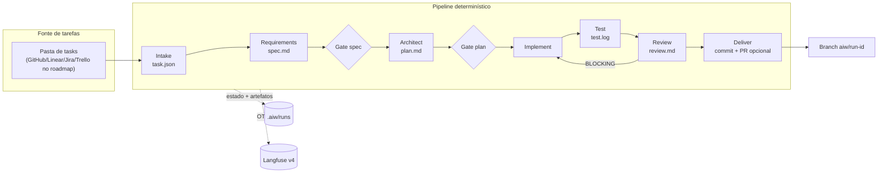
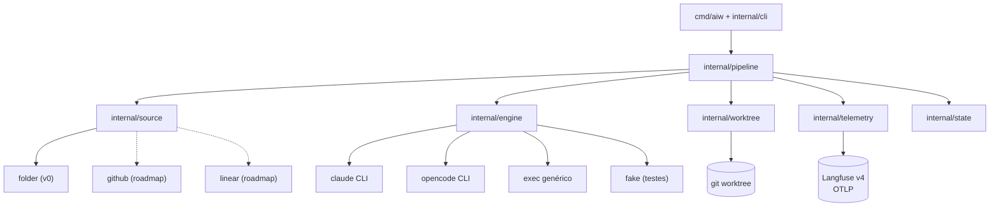

# aiw

[](https://github.com/donwellus/aiw/actions/workflows/ci.yml)
[](https://github.com/donwellus/aiw/actions/workflows/security.yml)
[](https://pkg.go.dev/github.com/donwellus/aiw)
[](LICENSE)

CLI em Go para orquestrar agentes de IA no ciclo de desenvolvimento: lê tarefas de uma fonte, executa um pipeline determinístico de estágios com artefatos e gates, entrega uma branch/PR e registra tudo no Langfuse.

## Por que este desenho

- O loop de agente (editar arquivos, rodar ferramentas) fica nos CLIs existentes (`claude`, `opencode`); o `aiw` orquestra.
- O pipeline é determinístico: cada estágio tem contrato de entrada/saída e grava artefatos auditáveis.
- Handoff entre agentes acontece por artefatos (`spec.md`, `plan.md`, `diff.patch`, `test.log`, `review.md`), não por conversa livre.
- Toda execução roda em um `git worktree` isolado, com branch própria e commit separado.
- Engines, fontes e telemetria são plugáveis por configuração.

## Instalação

```bash
go install github.com/donwellus/aiw/cmd/aiw@latest
```

Ou a partir do código:

```bash
git clone https://github.com/donwellus/aiw.git
cd aiw
make build
./bin/aiw version
```

## Como funciona





## Pipeline

1. **requirements** → `spec.md` + gate humano
2. **architect** → `plan.md` + gate humano
3. **implement** → alterações no worktree isolado
4. **test** → `test.log` com os comandos reais do projeto
5. **review** → `review.md` com loop de correção (máx. 2)
6. **deliver** → commit na branch `aiw/<run-id>` (+ PR com `--pr`)

Artefatos ficam em `.aiw/runs/<run-id>/` e o estado em `run.json`; eventos em `events.jsonl`. O write-back move a tarefa para `done`/`failed` na fonte.

## Requisitos

- Go 1.26.11+ (toolchain baixado automaticamente por versões recentes do Go)
- `git`
- `claude` e/ou `opencode` no PATH para execuções reais
- `gh` autenticado apenas para `--pr`
- Docker + Docker Compose para o Langfuse self-hosted v4 (opcional)

## Quickstart

```bash
# no repositório onde as tarefas serão executadas
aiw --root . init
$EDITOR tasks/001-exemplo.md

# ambiente
export ANTHROPIC_API_KEY=...          # se usar claude
# ou configure o opencode normalmente

# validação
aiw --root . doctor

# execução simulada (sem custo, sem LLM)
aiw --root . run --task tasks/001-exemplo.md --engine fake --auto

# execução real
aiw --root . run --task tasks/001-exemplo.md --auto
```

Gates interativos: sem `--auto`, o pipeline pausa em `spec` e `plan`:

```bash
aiw approve <run-id> spec
aiw resume <run-id>
```

## Comandos

| Comando | Função |
|---|---|
| `aiw init` | cria `.aiw/config.yaml`, `tasks/` e tarefa de exemplo |
| `aiw doctor` | valida engines, fontes, git, gh e Langfuse |
| `aiw sync` | busca tarefas e grava snapshots em `.aiw/queue/` |
| `aiw list [--eligible] [--json]` | lista tarefas da fonte |
| `aiw run --task <path\|source:id>` | executa o pipeline |
| `aiw runs [--json]` | lista execuções |
| `aiw status <run-id>` | estado, estágios, custo e eventos |
| `aiw approve <run-id> <gate>` | aprova `spec` ou `plan` |
| `aiw resume <run-id>` | retoma execução pausada/falha |

Flags úteis de `run`: `--repo`, `--engine`, `--auto`, `--budget`, `--pr`, `--force`, `--no-write-back`.

## Configuração

Arquivo `.aiw/config.yaml`. Variáveis `${VAR}` são expandidas do ambiente.

```yaml
engines:
  claude:
    driver: claude
    bin: claude
    permission_mode: acceptEdits
    allowed_tools: ["Read", "Grep", "Glob", "Edit", "Write", "Bash(git *)", "Bash(go test *)"]
  opencode:
    driver: opencode
    bin: opencode
    # auto_approve: true   # apenas em worktree isolado; libera edições no headless
  fake:
    driver: fake

defaults:
  engine: opencode
  timeout: 30m
  budget_usd: 5.00
  max_test_retries: 1
  max_review_rounds: 2

stages:
  requirements: {engine: claude}
  architect:    {engine: claude}
  implement:    {engine: opencode}
  review:       {engine: opencode}

telemetry:
  provider: langfuse        # noop | langfuse
  host: ${LANGFUSE_HOST}
  public_key: ${LANGFUSE_PUBLIC_KEY}
  secret_key: ${LANGFUSE_SECRET_KEY}
  capture: full             # full | metadata
  fail_open: true
  redact_secrets: true

sources:
  folder:
    driver: folder
    path: ./tasks
    done_dir: ./tasks/done
    failed_dir: ./tasks/failed

default_source: folder

workspace:
  default_repo: .
  test_commands: ["go test ./..."]
  gates: {spec: true, plan: true}
```

Precedência de engine: `--engine` > `stages.<estágio>.engine` > `defaults.engine`.

### Engines

- `claude`: modo headless `claude -p --output-format json`; custo/tokens vêm do JSON.
- `opencode`: `opencode run --format json --dir <worktree>`; parsing tolerante de eventos NDJSON.
- `exec`: qualquer CLI via `command` com placeholders `{{prompt}}`, `{{workdir}}`, `{{model}}`, `{{stage}}` e `prompt_via: arg|stdin`.
- `fake`: simulador para testes do pipeline, sem custo.

### Fontes

A v0 implementa `folder` (Markdown com frontmatter YAML). Os contratos `Source`, `StatusWriter`, `Commenter` e `Labeler` já existem para GitHub, Linear, Jira e Trello. O write-back da pasta move a tarefa para `done_dir`/`failed_dir`.

Frontmatter aceito:

```yaml
---
id: 123
title: Título
repo: ../outro-repo       # opcional; precedência: --repo > repo: > label repo:* > default_repo
labels: [aiw, backend]
priority: high
assignee: alguem
acceptance:
  - critério verificável
---
```

Sem frontmatter, o título vem do primeiro `# heading` e o id do nome do arquivo.

## Langfuse self-hosted

```bash
make telemetry-init          # gera infra/langfuse/.env com segredos aleatórios
make telemetry-up            # sobe web, worker, Postgres, ClickHouse, Redis, MinIO
source infra/langfuse/env.sh # exporta LANGFUSE_HOST/PUBLIC_KEY/SECRET_KEY
make telemetry-down
make telemetry-reset         # apaga volumes
```

UI: http://localhost:3000. O headless init cria usuário, organização, projeto e chaves a partir do `.env`.

O cliente Go envia traces via **OTLP HTTP** para `/api/public/otel/v1/traces` (header `x-langfuse-ingestion-version: 4`) com:

- 1 trace por run;
- 1 span por estágio;
- 1 generation por chamada de engine (prompt, output, modelo, tokens, custo, latência);
- events de gates/retries via spans de tipo `event`;
- scores de sucesso/custo via `POST /api/public/scores`.

`fail_open: true` garante que indisponibilidade do Langfuse não derruba o pipeline. `capture: metadata` omite prompts/outputs.

O Langfuse v4 roda em modo `events_only`: a API legada de traces está desabilitada e o caminho suportado é OTLP (`/api/public/otel/v1/traces`). A UI e a API `/api/public/v2/observations` mostram os dados; scores vão por `POST /api/public/scores`.

## Segurança

- Rode com `permission_mode`/allowlist; nunca use bypass de permissões no workspace principal. O agente trabalha em worktree isolado.
- Conteúdo de issues/tarefas é dado não confiável: trate como contexto, não como instrução; gates humanos são a barreira.
- Segredos apenas em variáveis de ambiente; `infra/langfuse/.env` é ignorado pelo git e criado com permissão 600.
- `redact_secrets` remove padrões comuns de token antes de enviar traces.
- O `aiw` não faz push nem abre PR sem `--pr`; o merge é sempre humano.

Para reportar vulnerabilidades, siga [SECURITY.md](SECURITY.md); não abra issue pública com detalhes exploráveis.

## Solução de problemas

- `claude` retorna `Failed to authenticate: OAuth session expired`: rode `claude` interativamente para refazer login ou exporte `ANTHROPIC_API_KEY`.
- `opencode` nega edições em modo headless: configure permissões no opencode ou use `auto_approve: true` na engine. O agente roda em worktree isolado; nunca habilite bypass no workspace principal.
- `aiw doctor` aponta Langfuse inacessível: confira `make telemetry-up`, a porta 3000 e se `source infra/langfuse/env.sh` foi carregado.
- `aiw run` não encontra a tarefa: confira `--root`, o caminho do arquivo e se o frontmatter tem `id` único.
- Go 1.26.11+ é o mínimo; o `go` baixa o toolchain necessário automaticamente. Rode `make check` após atualizar.

## Desenvolvimento

```bash
make check     # go vet + go test
make smoke     # executa o pipeline fake ponta a ponta em um repo temporário
make lint      # golangci-lint (opcional; requer instalação local)
```

Estrutura:

```
cmd/aiw              entrada da CLI
internal/cli         comandos
internal/config      config + env + defaults
internal/source      contratos de fontes
internal/source/folder
internal/sources     registry de fontes
internal/engine      contratos + adapters claude/opencode/exec/fake
internal/pipeline    máquina de estados, gates, artefatos, budget
internal/worktree    git worktree por run
internal/state       deduplicação/lock local
internal/telemetry   noop/recorder/langfuse
prompts              templates dos estágios (go:embed)
infra/langfuse       compose vendorizado + scripts de ambiente
docs/adr             decisões de arquitetura
```

## CI e qualidade

- `ci.yml`: build, `go vet`, `go test -race`, gofmt, golangci-lint e smoke test em Ubuntu (Go 1.26 e stable) e macOS.
- `security.yml`: gitleaks no histórico, `govulncheck` e dependency review em pull requests.
- Dependabot semanal para módulos Go e GitHub Actions.

O smoke test usa o engine `fake`: valida o pipeline inteiro sem LLM, sem rede e sem custo.

## Licença

Apache License 2.0. Veja [LICENSE](LICENSE).

Contribuições seguem o modelo inbound = outbound sob a mesma licença; veja [CONTRIBUTING.md](CONTRIBUTING.md).

## Limitações atuais

- Fonte apenas `folder`; conectores remotos são o próximo passo (GitHub → Linear → Jira → Trello).
- Evals ainda em tests de integração; a suíte `aiw eval` com tarefas golden é o próximo marco.
- Sem execução paralela entre tarefas.
- `resume` retoma por estágio; loops parciais de teste/review são reexecutados.
