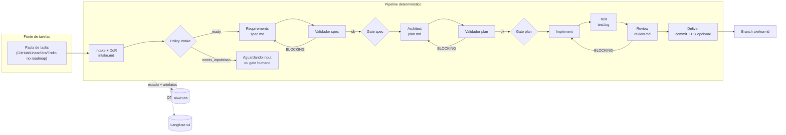
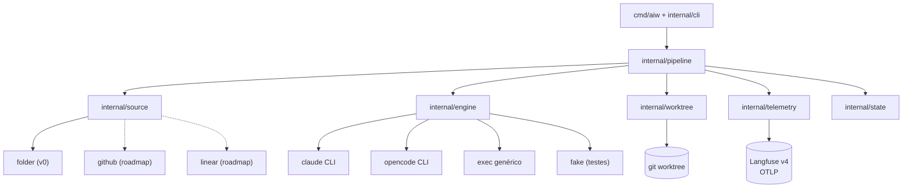

# aiw

[](https://github.com/donwellus/aiw/actions/workflows/ci.yml)
[](https://github.com/donwellus/aiw/actions/workflows/security.yml)
[](https://pkg.go.dev/github.com/donwellus/aiw)
[](LICENSE)

CLI em Go para orquestrar agentes de IA no ciclo de desenvolvimento: lê tarefas de uma fonte, executa um pipeline determinístico de estágios com artefatos e gates, entrega uma branch/PR e registra tudo no Langfuse.

## Por que este desenho

- O loop de agente (editar arquivos, rodar ferramentas) fica nos CLIs existentes (`claude`, `opencode`); o `aiw` orquestra.
- O pipeline é determinístico: cada estágio tem contrato de entrada/saída e grava artefatos auditáveis.
- Handoff entre agentes acontece por artefatos (`spec.md`, `plan.md`, `diff.patch`, `test.log`, `review.md`), não por conversa livre.
- Toda execução roda em um `git worktree` isolado, com branch própria e commit separado.
- Engines, fontes e telemetria são plugáveis por configuração.

## Instalação

```bash
go install github.com/donwellus/aiw/cmd/aiw@latest
```

Ou a partir do código:

```bash
git clone https://github.com/donwellus/aiw.git
cd aiw
make build
./bin/aiw version
```

## Como funciona





## Pipeline

0. **intake** → `intake.md`/`questions.md` + DoR + política (auto, `needs_input` ou humano)
1. **requirements** → `spec.md` + validador automático (`spec-review.md`) + gate
2. **architect** → `plan.md` + validador automático (`plan-review.md`) + gate
3. **implement** → alterações no worktree isolado
4. **test** → `test.log` com os comandos reais do projeto
5. **review** → `review.md` com loop de correção (máx. 2)
6. **deliver** → commit na branch `aiw/<run-id>` (+ PR com `--pr`)

Artefatos ficam em `.aiw/runs/<run-id>/` e o estado em `run.json`; eventos em `events.jsonl`. O write-back move a tarefa para `done`/`failed` na fonte; `needs_input` mantém a tarefa no inbox.

## Requisitos

- Go 1.26.11+ (toolchain baixado automaticamente por versões recentes do Go)
- `git`
- `claude` e/ou `opencode` no PATH para execuções reais
- `gh` autenticado apenas para `--pr`
- Docker + Docker Compose para o Langfuse self-hosted v4 (opcional)

## Quickstart

```bash
# no repositório onde as tarefas serão executadas
aiw --root . init
$EDITOR tasks/001-exemplo.md

# ambiente
export ANTHROPIC_API_KEY=...          # se usar claude
# ou configure o opencode normalmente

# validação
aiw --root . doctor

# execução simulada (sem custo, sem LLM)
aiw --root . run --task tasks/001-exemplo.md --engine fake --auto

# execução real
aiw --root . run --task tasks/001-exemplo.md --auto
```

Gates interativos: sem `--auto`, o pipeline pausa em `spec` e `plan`:

```bash
aiw approve <run-id> spec
aiw resume <run-id>
```

## Comandos

| Comando | Função |
|---|---|
| `aiw init` | cria `.aiw/config.yaml`, `tasks/` e tarefa de exemplo |
| `aiw doctor` | valida engines, fontes, git, gh e Langfuse |
| `aiw sync` | busca tarefas e grava snapshots em `.aiw/queue/` |
| `aiw list [--all] [--eligible] [--status] [--json]` | lista tarefas e status (inbox ou histórico local) |
| `aiw run --task <path\|source:id>` | executa o pipeline para uma tarefa |
| `aiw work --workers N [--auto]` | processa tarefas elegíveis em paralelo |
| `aiw daemon [--interval 60s]` | processa continuamente em intervalos |
| `aiw eval --suite <yaml>` | executa tarefas golden e mede sucesso/custo |
| `aiw intake <run-id>` | mostra intake e perguntas de uma execução |
| `aiw pause [run-id]` | sem id: pausa global (`.aiw/PAUSE`); com id: pausa uma execução |
| `aiw release <run-id>` | libera claim/estado de uma execução morta |
| `aiw runs [--json]` | lista execuções |
| `aiw status [run-id]` | sem id: tarefas em andamento; com id: estado, estágios e custo |
| `aiw report [--json\|--yaml\|--md\|--html] [--source <nome>]` | relatório read-only de todas as tarefas, custos, claims e alertas |
| `aiw clean [--dry-run] [--force] [--keep-branches] [--skip-superseded] [--json]` | remove worktrees e branches de runs terminais/superadas |
| `aiw mcp` | servidor MCP stdio read-only para o coordenador |
| `aiw approve <run-id> <gate>` | aprova `intake`, `spec` ou `plan` |
| `aiw resume <run-id>` | retoma execução pausada/falha |
| `aiw resume --all` | remove a pausa global e retoma runs paused/canceladas |

Flags úteis de `run`: `--repo`, `--engine`, `--auto`, `--budget`, `--pr`, `--force`, `--no-write-back`.

### Listando tarefas e status

```bash
aiw list                      # inbox (tasks/)
aiw list --all                # inbox + doing + done + failed
aiw list --all --status succeeded
aiw list --all --status needs_input
aiw list --all --json
aiw status                    # apenas o que está em andamento
```

- `aiw list` sem `--all` é a fila de entrada; `doing/`, `done/` e `failed/` ficam fora.
- `--all` (fonte `folder`) mostra tudo com colunas `STATUS` e `LOCAL`.
- Status vem do estado por tarefa; localização (`inbox/doing/done/failed`) serve de fallback para tarefas antigas sem registro.
- `aiw status` é o resumo vivo de running/paused/needs_input; deduplica pelo registro mais recente por ID (registros antigos de aliases não aparecem). `aiw status <run-id>` detalha uma execução.
- Aliases `folder`/`wave-*` apontando para a mesma pasta compartilham o claim canônico `folder:<pasta>:<id>`, evitando runs duplicadas.
- Para fontes remotas, `--all` ainda não existe; use `aiw runs` para histórico de execuções.

### Relatório (`aiw report`)

```bash
aiw report                              # tabela: resumo, tarefas, claims e alertas
aiw report --json                       # automação
aiw report --yaml
aiw report --md
aiw report --html > report.html         # HTML autocontido
aiw report --source folder --md         # inclui inbox/doing/done/failed do folder
```

- É **somente leitura**: agrega `.aiw/state` + `.aiw/runs` sem alterar estado, claims ou execuções.
- Mostra todas as tarefas conhecidas, inclusive `succeeded`, `failed`, `canceled` e `paused`, com estágio, última run e custo.
- Custo: o resumo soma **todas as runs** (custo real acumulado, incluindo retries); a coluna por tarefa usa a **última run**.
- `--source <nome>` é opcional e faz chamadas à fonte: no folder inclui inbox+doing+done+failed (tarefas nunca executadas aparecem como `todo`); em fontes remotas inclui o inbox atual. Sem a flag, o relatório funciona offline.
- `--json`, `--yaml`, `--md` e `--html` são mutuamente exclusivos; a tabela é o padrão.
- Alertas incluem failed, needs_input, paused, pausa global, claims vencidos e estado apontando para run ausente.
- `aiw status` continua sendo o resumo operacional curto; use `aiw report` para visão histórica/completa.

### Limpeza (`aiw clean`)

```bash
aiw clean --dry-run                      # mostra o que seria removido
aiw clean                                # worktrees terminais + branches merged
aiw clean --keep-branches                # remove só worktrees
aiw clean --force                        # inclui worktrees sujos e branches não merged
aiw clean --status succeeded --json      # restringe o status e gera JSON
aiw clean --skip-superseded              # mantém runs antigas needs_input/paused
```

- Padrão: runs `succeeded`, `failed` e `canceled`, sem claim ou estado ativo.
- Também limpa por padrão runs `needs_input`/`paused` **superadas**: existe um estado mais recente da mesma tarefa (`succeeded`/`failed`) apontando para outra run. `--skip-superseded` desativa.
- A tarefa é identificada pela claim key canônica (aliases folder incluídos); runs `running` e estados ainda ativos ficam de fora.
- Worktree é removido com `git worktree remove`; se estiver sujo, é preservado até `--force`.
- Branch local `aiw/<run-id>` só é apagada se estiver merged na branch padrão; `--force` usa `-D`.
- Nunca remove `.aiw/runs`: custo/histórico do `report` permanece.
- Após remover ou detectar worktree ausente, roda `git worktree prune`.
- Proteção contra corrida: `clean` adquire o claim da tarefa, relê `run.json` e só então remove.
- `--force` não remove run ativa/claim ativo; branch remota/PR não é tocada.
- Merge é verificado localmente, sem `fetch`; branches squash-merged ou remotas exigem `--force` consciente.

### Coordenador via OpenCode + MCP

O aiw expõe um control plane read-only para um agente coordenador persistente:

```bash
aiw daemon --workers 2 --interval 60s   # workers em outro processo
aiw mcp                                 # servidor MCP stdio (usado pelo OpenCode)
```

- O coordenador recomendado é um agente primário do OpenCode com permissões
  negando `edit`, `shell` e `subagent`.
- Ele conversa com você e consulta `aiw_status`, `aiw_report`, `aiw_runs`,
  `aiw_run_show` e `aiw_events`.
- Workers continuam sendo runs do pipeline, executadas pelo daemon em worktrees
  isolados; o coordenador nunca trabalha nas tarefas.
- Setup e exemplo de agente: [docs/coordinator.md](docs/coordinator.md) e
  [examples/opencode](examples/opencode).
- Fase atual: somente leitura. Controle (`pause`, `resume`, `approve`, `clean`,
  `cancel`) e notificações proativas ficam para as próximas fases.

### Paralelismo (`aiw work`)

```bash
aiw work --workers 2 --auto
aiw work --workers 3 --auto --max-tasks 6 --budget 2 --json
aiw list --eligible
aiw list --status running
aiw release <run-id>
```

- Cada tarefa é reivindicada por um **claim atômico** (`O_EXCL`) em `.aiw/state/claims`, com TTL e heartbeat enquanto a run está viva.
- O estado fica por tarefa em `.aiw/state/tasks` (migra automaticamente o antigo `tasks.json`).
- Cada worker usa seu próprio worktree/branch; a criação é serializada por repo (mutex + lock de arquivo), então múltiplos pools não colidem no git.
- Limites: `--workers` global, `max_concurrency` por engine e `max_test_concurrency` por repositório.
- Tarefas de risco/`needs_input` pausam ou saem da fila sem derrubar os outros workers; `--auto` sobrepõe gates humanos.
- Saída: uma linha por tarefa (`ok`, `falhou`, `needs_input`, `ignorada`, `cancelada`); `--json` emite JSONL.
- Ctrl+C/SIGTERM drena: para de enfileirar e termina os runs em andamento; segundo Ctrl+C força o cancelamento.
- `aiw release` serve para runs que morreram sem liberar o claim/estado.

Limitações atuais do pool: `tasks/` é local ao clone; conectores remotos e evals são os próximos marcos.

### Daemon (`aiw daemon`)

```bash
aiw daemon --workers 2 --interval 60s
aiw daemon --once --workers 2 --auto          # um ciclo, útil para cron/testes
aiw daemon --status-addr 127.0.0.1:8787       # /healthz e /status em JSON
```

- Faz polling da fonte a cada `--interval`, coleta tarefas elegíveis e usa o mesmo pool/claim do `aiw work`.
- Sem resumo global fixo: imprime uma linha por tarefa concluída e uma linha por ciclo quando há trabalho.
- `/status` traz um resumo vivo (ciclos, totais por status, runs em andamento, claims); `/healthz` responde `ok`.
- Nunca abre prompt; gates humanos pausam a tarefa e liberam o slot.
- `aiw pause` sem run-id ativa o **modo idle**: o daemon para de coletar, mantém `/status`, `/healthz` e webhooks vivos e volta sozinho quando `aiw resume --all` remove `.aiw/PAUSE`.
- Tarefas `paused`/`needs_input` ficam fora da fila até `resume` ou mudança de conteúdo.
- SIGINT/SIGTERM drena o que está em andamento; `--drain-timeout` limita a espera e o segundo SIGINT força.
- `--pause-poll` (default 10s) controla a checagem da pausa global no `work` e no idle do daemon.
- **Webhooks GitHub** (`--webhook-addr`): o endpoint `/webhooks/github` valida HMAC (`X-Hub-Signature-256`), deduplica por `X-GitHub-Delivery`, responde 202 e acorda o ciclo do daemon. O payload não vira task direto: o daemon reconsulta a issue via `gh`. Use HTTPS/reverse proxy ou túnel em dev; o polling continua como fallback. Requer `webhook_secret_env` (default `GITHUB_WEBHOOK_SECRET`).

### Pasta doing opcional

```yaml
sources:
  folder:
    doing_dir: ./tasks/doing
```

- Se configurada, a tarefa é movida atomicamente para `doing/` no claim, dando visibilidade e um claim por rename.
- `paused` permanece em `doing`; `needs_input`/cancelado voltam ao inbox; `done`/`failed` vão para as pastas finais.
- `aiw release <run-id>` libera claim/estado e devolve a tarefa ao inbox.
- Sem `doing_dir` (default), o claim atômico em `.aiw/state/claims` continua valendo.

### Evals (`aiw eval`)

```bash
aiw eval --suite evals/smoke/suite.yaml --engine fake   # valida o harness
aiw eval --suite minhas-golden/suite.yaml                # engine real do config
aiw eval --suite ... --budget 2 --json --out /tmp/eval
```

Suite:

```yaml
name: meu-projeto
engine: opencode          # opcional; pode vir do config ou --engine
timeout: 30m
judge:                    # opcional; score de 0 a 10
  engine: claude
  threshold: 7            # 0 = apenas informativo
  rubric: "Correção, testes e escopo"
cases:
  - id: fix-off-by-one
    task: tasks/001.md       # relativo à suite
    repo: fixtures/repo      # relativo à suite (git clone ou pasta simples)
    base_ref: main           # opcional
    reference_ref: ref-solucao  # opcional; similaridade do diff
    verify: go test ./...
```

- Cada caso roda em um clone/cópia temporário, com worktree e estado isolados; o repositório original não é tocado.
- Métricas por caso: status do pipeline, verificação (`verify`), custo, duração, run/branch, artefatos copiados, **score do judge** e **similaridade com `reference_ref`**.
- `results.json` é gravado em `.aiw/evals/<timestamp>/` (ou `--out`); exit code 1 se qualquer caso falhar.
- Telemetria fica `noop` nos evals para não poluir traces de produção.
- `evals/smoke/suite.yaml` + `make eval-smoke` validam o harness com engine `fake`.
- O judge usa o engine/modelo configurado (`judge.engine`/`judge.model`) e só bloqueia quando `judge.threshold > 0`.
- Similaridade de referência é informativa (Jaccard das linhas alteradas), não bloqueia.
- Evals são sequenciais nesta versão.

### Pausar e continuar

```bash
aiw pause                    # pausa global: para de agendar novas tarefas
aiw resume --all             # remove a pausa global e retoma paused/canceladas
aiw pause <run-id>           # pausa apenas uma execução
aiw resume <run-id>          # retoma pausa/gate/cancelamento
```

- `pause` por run grava um marker e o pipeline para **no boundary entre estágios**; o tool call atual termina.
- Claim é liberado e a tarefa permanece em `doing` (folder) ou com label/estado de running (remotos).
- `resume` reivindica de novo, reaplica `MarkRunning`, remove o marker e continua do próximo estágio.
- Não há retomada no meio de um estágio: se o estágio falhou/cancelou, ele recomeça.
- **Pausa global** (`aiw pause` sem id) grava `.aiw/PAUSE`:
  - runs em andamento pausam no próximo boundary;
  - `work` e `run` recusam iniciar novas tarefas;
  - `daemon` fica **idle** (não coleta), mantendo status/webhooks, e volta quando o marker some;
  - `resume <run-id>` é bloqueado; use `resume --all` para limpar o marker e retomar paused/canceladas.
- Em `work`/`daemon`, o **primeiro SIGINT** drena: para de enfileirar, termina o run atual e sai; `--drain-timeout` (default 5m) limita a espera.
- **Segundo SIGINT** ou timeout força o cancelamento; runs canceladas podem ser retomadas com `aiw resume`.
- Tarefas ainda não iniciadas permanecem no inbox/fila.

### Intake e gates automáticos

- **DoR**: descrição mínima, critérios de aceite (do source ou propostos no intake) e perguntas abertas.
- O agente de intake grava `intake.md` e `questions.md` e termina com `DECISION: READY|NEEDS_INPUT` e `RISK: LOW|MEDIUM|HIGH`.
- **Política**: `needs_input` para tarefa incompleta; risco alto ou labels como `risk:high`, `security`, `db-migration` escalam para humano; caso contrário segue automático.
- `needs_input` não é falha: a tarefa fica no inbox, o claim é liberado e o estado aparece em `aiw list --status needs_input`. Edite a tarefa na fonte (o hash muda) e rode novamente.
- **Spec/plan**: validadores com contexto limpo, até `max_gate_rounds` tentativas de correção. Se continuar reprovando, o gate escala para humano (`aiw approve` + `aiw resume`).
- `--auto` aprova gates humanos (inclusive risco no intake); falhas de validação automática após `max_gate_rounds` continuam escalando para revisão.

## Configuração

Arquivo `.aiw/config.yaml`. Variáveis `${VAR}` são expandidas do ambiente.

```yaml
engines:
  claude:
    driver: claude
    bin: claude
    max_concurrency: 1
    permission_mode: acceptEdits
    allowed_tools: ["Read", "Grep", "Glob", "Edit", "Write", "Bash(git *)", "Bash(go test *)"]
  opencode:
    driver: opencode
    bin: opencode
    max_concurrency: 2
    # auto_approve: true   # apenas em worktree isolado; libera edições no headless
  fake:
    driver: fake

defaults:
  engine: opencode
  timeout: 30m
  budget_usd: 5.00
  max_test_retries: 1
  max_review_rounds: 2
  max_gate_rounds: 2
  workers: 2
  claim_ttl: 2h

stages:
  intake:       {engine: claude}
  requirements: {engine: claude}
  architect:    {engine: claude}
  implement:    {engine: opencode}
  review:       {engine: opencode}

telemetry:
  provider: langfuse        # noop | langfuse
  host: ${LANGFUSE_HOST}
  public_key: ${LANGFUSE_PUBLIC_KEY}
  secret_key: ${LANGFUSE_SECRET_KEY}
  capture: full             # full | metadata
  fail_open: true
  redact_secrets: true

sources:
  folder:
    driver: folder
    path: ./tasks
    # doing_dir: ./tasks/doing   # opcional: visibilidade/claim por rename
    done_dir: ./tasks/done
    failed_dir: ./tasks/failed

default_source: folder

workspace:
  default_repo: .
  test_commands: ["go test ./..."]
  max_test_concurrency: 1
  gates:
    intake: policy
    spec: auto
    plan: auto

intake:
  risk_labels: ["risk:high", "security", "db-migration"]
  min_description_chars: 10
```

Precedência de engine: `--engine` > `stages.<estágio>.engine` > `defaults.engine`.

### MCP para agentes

O source do Linear continua sendo GraphQL (determinístico). Opcionalmente, os agentes podem receber o **Linear MCP read-only** como ferramenta de contexto durante intake/spec:

```yaml
engines:
  claude:
    mcp:
      linear:
        url: https://mcp.linear.app/mcp/readonly
        headers:
          Authorization: Bearer ${LINEAR_API_KEY}
  opencode:
    mcp:
      linear:
        url: https://mcp.linear.app/mcp/readonly
        headers:
          Authorization: Bearer ${LINEAR_API_KEY}
```

- O `aiw` gera a configuração MCP por engine em `.aiw/mcp/` (0600, gitignored) e não loga headers/chaves.
- Claude Code recebe `--mcp-config <arquivo>` e libera `mcp__linear` via `allowed_tools`; opencode recebe `OPENCODE_CONFIG=<arquivo>` com `oauth: false` e permissão `linear_*`.
- Sem `LINEAR_API_KEY`, o servidor MCP é ignorado com aviso (não quebra a run).
- Prefira `/mcp/readonly`: o write-back oficial continua no source GraphQL, evitando que o agente mude o Linear por fora do pipeline.
- Nesta versão autenticamos por API key; OAuth interativo do MCP fica para depois.

### Engines

- `claude`: modo headless `claude -p --output-format json`; custo/tokens vêm do JSON.
- `opencode`: `opencode run --format json --dir <worktree>`; parsing tolerante de eventos NDJSON.
- `exec`: qualquer CLI via `command` com placeholders `{{prompt}}`, `{{workdir}}`, `{{model}}`, `{{stage}}` e `prompt_via: arg|stdin`.
- `fake`: simulador para testes do pipeline, sem custo.

### Fontes

Implementadas: `folder`, `github`, `linear`, `jira` e `trello`.

#### GitHub

```yaml
sources:
  github:
    driver: github
    repo: owner/name
    repo_path: ../app          # checkout local correspondente
    state: open
    labels: [aiw]
    exclude_labels: [aiw:running, aiw:done, aiw:failed]
    comment: true
    close_on_done: false
    webhook_secret_env: GITHUB_WEBHOOK_SECRET
```

```bash
aiw list --source github
aiw run --source github --task github:123 --repo ../app --auto
aiw work --source github --workers 2
aiw daemon --source github --interval 60s
```

- Lê issues via `gh` (precisa estar autenticado): título, corpo, labels, assignee e comentários entram no contexto.
- Itens `- [ ]`/`- [x]` do corpo viram critérios de aceite.
- Write-back: `aiw:running` no claim; `aiw:done`/`aiw:failed` ao final, com comentário de run/branch/PR/custo; opcional fechar a issue (`close_on_done`).
- `needs_input`/cancelamento removem `aiw:running` e liberam o claim.
- `aiw release` remove `aiw:running` e devolve estado local para `todo`.
- O repositório local é resolvido por `repo_path`, `repo:`/label `repo:*` ou `workspace.default_repo`.

#### Linear

```yaml
sources:
  linear:
    driver: linear
    team: ENG
    repo_path: ../app
    states: [Todo, "In Progress"]
    running_state: In Progress
    done_state: Done
    failed_state: Todo
    pending_state: Todo
    comment: true
    # api_key_env: LINEAR_API_KEY
```

```bash
export LINEAR_API_KEY=...
aiw list --source linear
aiw run --source linear --task linear:ENG-123 --repo ../app --auto
aiw work --source linear --workers 2
aiw daemon --source linear --interval 60s
```

- GraphQL API (`api.linear.app/graphql`), lendo título, descrição, labels, assignee, estado e comentários.
- Checklists `- [ ]` viram critérios de aceite.
- Write-back move o estado para `running_state`/`done_state`/`failed_state` e comenta run/branch/PR/custo; `needs_input`/cancelado vão para `pending_state`.
- `aiw doctor` valida a API key, o viewer e o time.
- O time é obrigatório; `states` filtra o que entra na fila; `repo_path` mapeia para o checkout local.

#### Jira

```yaml
sources:
  jira:
    driver: jira
    base_url: https://empresa.atlassian.net
    jql: 'project = APP AND status = "To Do" ORDER BY updated DESC'
    repo_path: ../app
    running_transition: In Progress
    done_transition: Done
    failed_transition: To Do
    pending_transition: To Do
    comment: true
    # email_env: JIRA_EMAIL
    # token_env: JIRA_API_TOKEN
```

```bash
export JIRA_EMAIL=voce@empresa.com JIRA_API_TOKEN=...
aiw list --source jira
aiw run --source jira --task jira:APP-123 --repo ../app --auto
aiw work --source jira --workers 2
aiw daemon --source jira --interval 60s
```

- REST API v3 (`search/jql`, ADF): lê resumo, descrição, status, labels, assignee e comentários.
- Checklists ADF e `- [ ]` no texto viram critérios de aceite.
- Write-back por transição (`running_transition`, etc.) e comentário com run/branch/PR/custo.
- `aiw doctor` valida autenticação em `/myself`.
- `jql` ou `project` é obrigatório para definir a fila.

#### Trello

```yaml
sources:
  trello:
    driver: trello
    board: boardId
    list: "To Do"
    running_list: "Doing"
    done_list: "Done"
    failed_list: "Blocked"
    pending_list: "To Do"
    repo_path: ../app
    comment: true
    # key_env: TRELLO_KEY
    # token_env: TRELLO_TOKEN
```

```bash
export TRELLO_KEY=... TRELLO_TOKEN=...
aiw list --source trello
aiw run --source trello --task trello:abc123 --repo ../app --auto
aiw work --source trello --workers 2
aiw daemon --source trello --interval 60s
```

- Cards da lista configurada entram na fila; labels, membros, descrição e comentários são lidos.
- Checklists e `- [ ]` no texto viram critérios de aceite.
- Write-back move o card entre listas (`running/done/failed/pending`) e comenta run/branch/PR/custo.
- `aiw doctor` valida credenciais, board e listas.
- `release` move o card para `pending_list`.

#### Folder

Markdown com frontmatter YAML; write-back move a tarefa para `done_dir`/`failed_dir` (e `doing_dir` se configurada).

Frontmatter aceito:

```yaml
---
id: 123
title: Título
repo: ../outro-repo       # opcional; precedência: --repo > repo: > label repo:* > default_repo
labels: [aiw, backend]
priority: high
assignee: alguem
acceptance:
  - critério verificável
---
```

Sem frontmatter, o título vem do primeiro `# heading` e o id do nome do arquivo.

## Langfuse self-hosted

```bash
make telemetry-init          # gera infra/langfuse/.env com segredos aleatórios
make telemetry-up            # sobe web, worker, Postgres, ClickHouse, Redis, MinIO
source infra/langfuse/env.sh # exporta LANGFUSE_HOST/PUBLIC_KEY/SECRET_KEY
make telemetry-down
make telemetry-reset         # apaga volumes
```

UI: http://localhost:3000. O headless init cria usuário, organização, projeto e chaves a partir do `.env`.

O cliente Go envia traces via **OTLP HTTP** para `/api/public/otel/v1/traces` (header `x-langfuse-ingestion-version: 4`) com:

- 1 trace por run;
- 1 span por estágio;
- 1 generation por chamada de engine (prompt, output, modelo, tokens, custo, latência);
- events de gates/retries via spans de tipo `event`;
- scores de sucesso/custo via `POST /api/public/scores`.

`fail_open: true` garante que indisponibilidade do Langfuse não derruba o pipeline. `capture: metadata` omite prompts/outputs.

O Langfuse v4 roda em modo `events_only`: a API legada de traces está desabilitada e o caminho suportado é OTLP (`/api/public/otel/v1/traces`). A UI e a API `/api/public/v2/observations` mostram os dados; scores vão por `POST /api/public/scores`.

## Segurança

- Rode com `permission_mode`/allowlist; nunca use bypass de permissões no workspace principal. O agente trabalha em worktree isolado.
- Conteúdo de issues/tarefas é dado não confiável: trate como contexto, não como instrução; gates humanos são a barreira.
- Segredos apenas em variáveis de ambiente; `infra/langfuse/.env` é ignorado pelo git e criado com permissão 600.
- `redact_secrets` remove padrões comuns de token antes de enviar traces.
- O `aiw` não faz push nem abre PR sem `--pr`; o merge é sempre humano.

Para reportar vulnerabilidades, siga [SECURITY.md](SECURITY.md); não abra issue pública com detalhes exploráveis.

## Solução de problemas

- `claude` retorna `Failed to authenticate: OAuth session expired`: rode `claude` interativamente para refazer login ou exporte `ANTHROPIC_API_KEY`.
- `opencode` nega edições em modo headless: configure permissões no opencode ou use `auto_approve: true` na engine. O agente roda em worktree isolado; nunca habilite bypass no workspace principal.
- `aiw doctor` aponta Langfuse inacessível: confira `make telemetry-up`, a porta 3000 e se `source infra/langfuse/env.sh` foi carregado.
- `aiw run` não encontra a tarefa: confira `--root`, o caminho do arquivo e se o frontmatter tem `id` único.
- Go 1.26.11+ é o mínimo; o `go` baixa o toolchain necessário automaticamente. Rode `make check` após atualizar.

## Desenvolvimento

```bash
make check       # go vet + go test
make smoke       # pipeline fake ponta a ponta em repo temporário
make eval-smoke  # executa uma suite golden mínima com engine fake
make verify      # eval-smoke + concorrência/claims/daemon/doing/cancelamento
make lint        # golangci-lint (requer instalação local)
```

Estrutura:

```
cmd/aiw              entrada da CLI
internal/cli         comandos
internal/config      config + env + defaults
internal/source      contratos de fontes
internal/source/folder
internal/sources     registry de fontes
internal/engine      contratos + adapters claude/opencode/exec/fake
internal/runner      claim, estado por tarefa e pool de workers
internal/pipeline    máquina de estados, gates, artefatos, budget
internal/worktree    git worktree por run
internal/state       deduplicação/lock local
internal/telemetry   noop/recorder/langfuse
prompts              templates dos estágios (go:embed)
infra/langfuse       compose vendorizado + scripts de ambiente
docs/adr             decisões de arquitetura
```

## CI e qualidade

- `ci.yml`: build, `go vet`, `go test -race`, gofmt, golangci-lint e smoke test em Ubuntu (Go 1.26 e stable) e macOS; job `integration` roda `make verify`.
- `security.yml`: gitleaks no histórico, `govulncheck` e dependency review em pull requests.
- Dependabot semanal para módulos Go e GitHub Actions.

O smoke test usa o engine `fake`: valida o pipeline inteiro (intake, validadores e entrega) sem LLM, sem rede e sem custo. O `make verify` roda o eval smoke e usa um engine `exec` lento e dois pools concorrentes para provar exactly-once, isolamento de artefatos, falha independente, cancelamento, `needs_input` → edição → reprocessamento, pasta `doing`, daemon, pausa global, `report` em todos os formatos, `clean` e release.

## Licença

Apache License 2.0. Veja [LICENSE](LICENSE).

Contribuições seguem o modelo inbound = outbound sob a mesma licença; veja [CONTRIBUTING.md](CONTRIBUTING.md).

## Limitações atuais

- Fontes `folder`, `github`, `linear`, `jira` e `trello`; MCP opcional para agentes.
- Webhooks implementados para GitHub; Linear/Jira/Trello ficam para as próximas fases. OAuth do MCP também.
- Evals cobrem pipeline + verify + judge opcional + similaridade de referência; execução paralela de casos ainda não.
- `tasks/` é local ao clone; daemon e conectores remotos (GitHub/Linear/Jira/Trello) cobrem o uso compartilhado.
- `resume` retoma por estágio; loops parciais de teste/review são reexecutados.
- `needs_input` exige editar a tarefa e iniciar uma nova run; não há comando de resposta inline ainda.
- Pausa é por estágio; não há checkpoint dentro de um tool call. Retomada de paused/canceladas é explícita (`aiw resume <id>` ou `aiw resume --all`).
- Daemon processa uma máquina/clone por vez; claim entre máquinas depende de `doing`/fonte compartilhada ou conector remoto.
- Worktrees/branches não são removidos automaticamente após a entrega; use `aiw clean` (branches remotas/PRs não são apagadas).
- O coordenador via MCP é read-only; ações de execução/controle pelo agente ainda não estão expostas.
- O coordenador requer um processo OpenCode/servidor e um daemon vivos; sem daemon ele só lê o estado.
